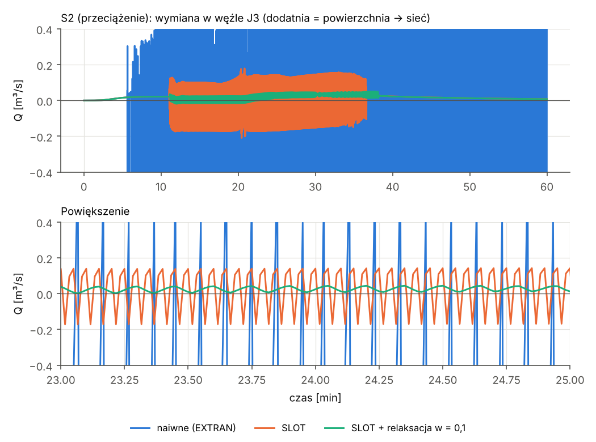
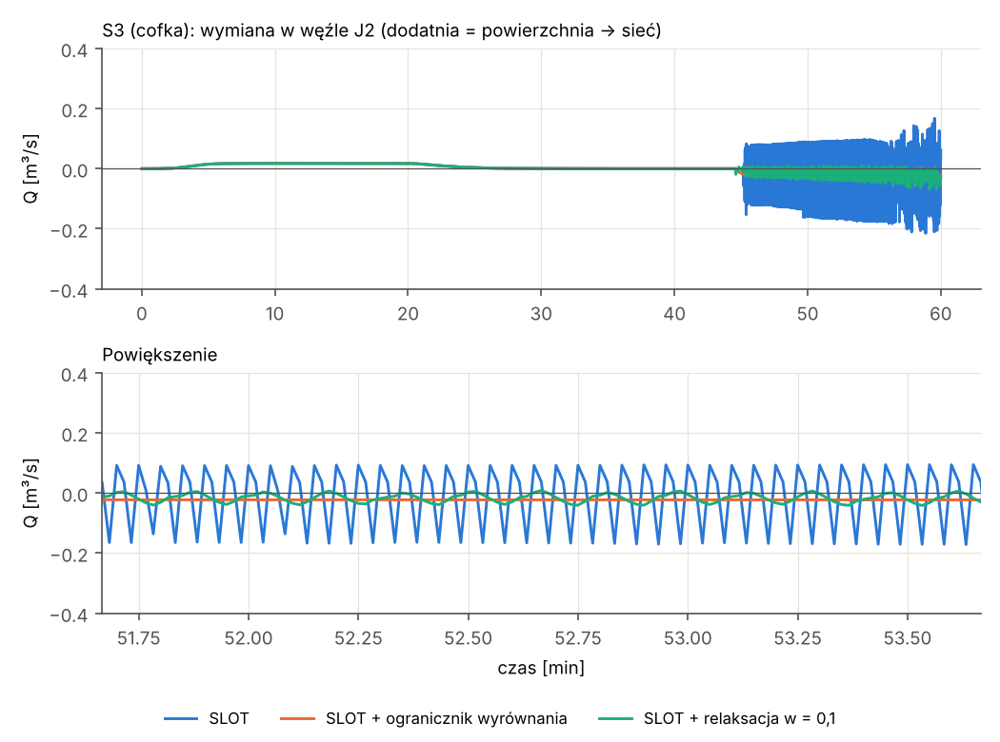
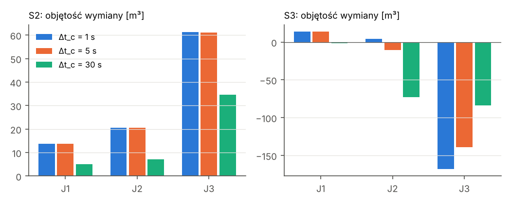
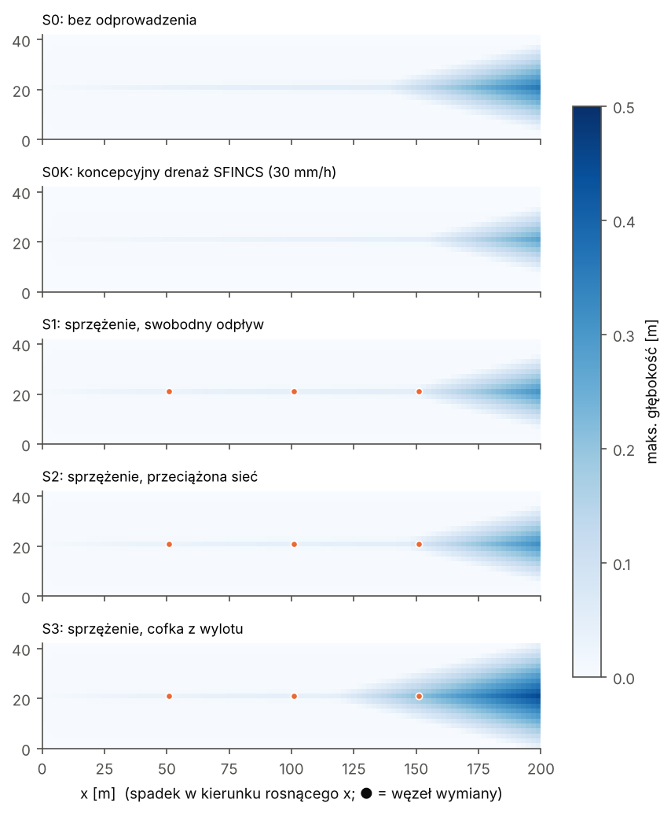
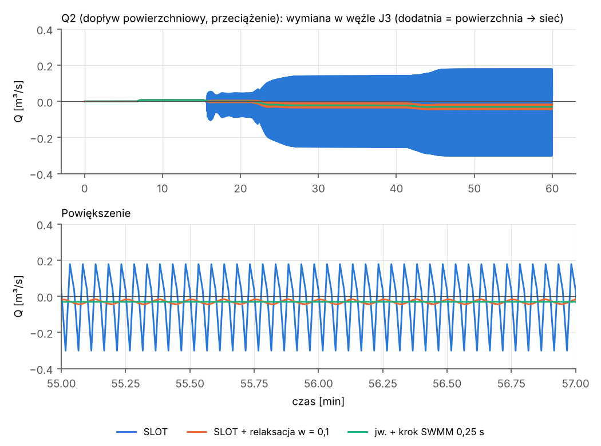
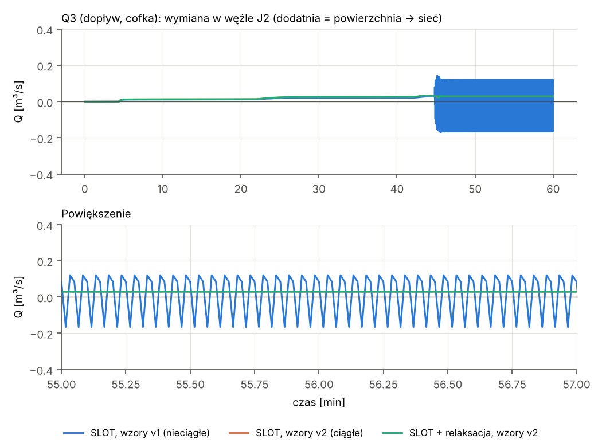
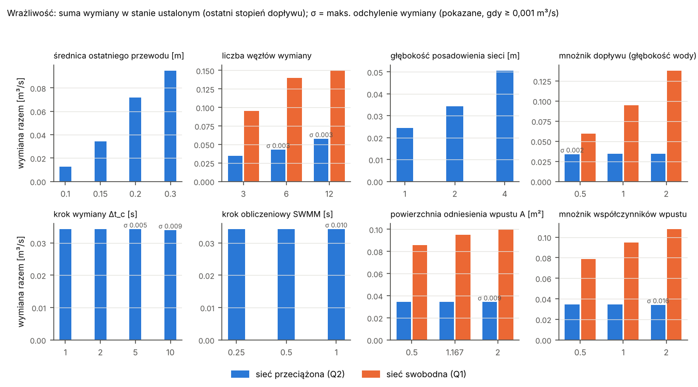

# Sprzężenie SFINCS–SWMM przez BMI: test wykonalności

Status: eksperyment (2026-10-20). Wstęp do krótkiej publikacji metodycznej; nie jest
to jeszcze część pakietu Hydraulik.

## 1. Cel

Sprawdzić, czy model 2D SFINCS (Deltares) można sprząc z modelem sieci 1D EPA SWMM 5
w schemacie podwójnego drenażu (*dual drainage*): woda z powierzchni wpływa do sieci
przez węzły wymiany, a przy przeciążeniu sieci lub cofce wraca na powierzchnię.
Pytania, w kolejności:

1. Czy technicznie da się prowadzić oba modele krok w krok i wymieniać wodę?
2. Czy sprzężenie zachowuje masę?
3. Czy wynik jest numerycznie stabilny i fizycznie sensowny; od czego to zależy?

Poza zakresem: dane rzeczywiste, siatka subgrid i quadtree, infiltracja, wydajność
na dużych domenach, kalibracja i walidacja względem pomiarów.

## 2. Metodyka

### 2.1 Domena 2D (SFINCS)

Domena idealizowana, dobrana tak, żeby każdy wynik dało się zinterpretować:

| Parametr | Wartość |
|---|---|
| Wymiar | 200 m × 42 m |
| Siatka | regularna, 2 m × 2 m (100 × 21 = 2100 komórek), bez subgrid |
| Powierzchnia | spadek podłużny 0,5% (w kierunku rosnącego x), poprzeczny 2% do linii spływu y = 21 m |
| Szorstkość | Manning n = 0,015 s/m^(1/3), stała |
| Infiltracja | brak |
| Brzegi | wszystkie zamknięte; wodę może wyprowadzić tylko sieć 1D |
| Parametry numeryczne | `alpha` = 0,5, `dtmax` = 1 s, `huthresh` = 0,001 m |
| Opad | równomierny, blokowy: 60 mm/h przez 20 min (168,07 m³); symulacja 60 min |

Zamknięte brzegi są celowe: bilans masy domyka się wtedy dokładnie
(opad = woda na powierzchni + woda w sieci + odpływ wylotem).

### 2.2 Sieć 1D (SWMM)

Trzy węzły wymiany na linii spływu: J1 (x = 51 m), J2 (101 m), J3 (151 m), oraz wylot
OUT (200 m). Dno węzłów 2 m pod powierzchnią, przewody kołowe o spadku 0,5%,
n = 0,013. Fala dynamiczna (`DYNWAVE`), stały krok 1 s (`VARIABLE_STEP 0`),
`MIN_SURFAREA` = 1,167 m², bardzo duża głębokość nadpiętrzenia węzłów (100 m),
żeby SWMM nigdy nie wylewał wody sam: o każdym wypływie na powierzchnię decyduje
koordynator.

| Wariant sieci | Średnice C1 / C2 / C3 | Wylot |
|---|---|---|
| swobodny odpływ (S1) | 0,6 / 0,6 / 0,6 m | swobodny |
| przeciążenie (S2) | 0,3 / 0,3 / 0,15 m | swobodny |
| cofka (S3) | 0,6 / 0,6 / 0,6 m | poziom wody rośnie od 7,0 m (30 min) do 9,6 m (45 min), powyżej terenu przy J2 i J3 |

### 2.3 Schemat sprzężenia

SFINCS jest sterowany przez BMI (biblioteka `libsfincs.so`, wywołania przez `ctypes`):
odczyt `zs` (poziom wody), zapis `qext` (zewnętrzne źródło/ujście, m³/s na komórkę).
SWMM jest sterowany przez `pyswmm` (odczyt ciśnienia w węźle, wpływ boczny węzła).

Koordynator działa jawnie, z synchronizacją w punktach wymiany `t_k = k·Δt_c`:

1. Odczytaj `zs` w komórce każdego węzła i ciśnienie `H` w węźle.
2. Policz wymianę `Q` (dodatnia = powierzchnia → sieć) wzorami ciągłymi (wersja v2,
   p. 2.8). `z_t` to rzędna terenu (krawędź włazu):
   - `H ≥ zs` (wybicie): `Q = −Q_o(H − zs)`,
   - `H < zs` (wpływ): `Q = min(Q_w · f_V, Q_o(zs − max(H, z_t)))`, gdzie
     `Q_w = ⅔·C_w·P·(zs − z_t)^1,5·√(2g)` to przelew swobodny, a `f_V` to poprawka
     na zatopienie (Villemonte): `f_V = (1 − ((H − z_t)/(zs − z_t))^1,5)^0,385`
     dla `H > z_t`, inaczej 1,
   - otwór: `Q_o(Δh) = C_o·A·√(2g·Δh)`, liniowo dla `Δh` < 1 cm (ograniczone nachylenie),
   - współczynniki skalibrowane dla włazu (Rubinato i in. 2017): `C_w` = 0,54,
     `C_o` = 0,167; `A` = 1,167 m² (powierzchnia węzła SWMM), `P = 2√(πA)` = 3,83 m,
     jak w Itzï.
3. Opcjonalnie stabilizacja (p. 2.5).
4. Ogranicz `Q > 0` do wody dostępnej w komórce: `Q ≤ h·A_cell / (Δt_c + dtmax)`.
5. Ustaw `qext = −Q` i przesuń SFINCS do `t_{k+1}` (`update_until`).
6. Odczytaj faktyczny czas SFINCS-a i policz objętość, która opuściła powierzchnię:
   `V = Q·(t_SFINCS,nowy − t_SFINCS,stary)`.
7. Przekaż SWMM dokładnie tę objętość jako wpływ boczny `V/Δt_c` i przesuń go o `Δt_c`.

### 2.4 Synchronizacja kroków czasowych

SFINCS ma krok adaptacyjny (CFL), a SWMM stały. Z kodu SFINCS-a wynika, że
`update_until` **nie przycina** ostatniego kroku, więc model przestrzeliwuje cel o
maksymalnie jeden swój krok. Cele są bezwzględne, więc przesunięcie się nie kumuluje.

Rozwiązanie zastosowane w teście:
- **wymiana objętości, nie przepływów** (krok 6–7): bilans jest dokładny z samej
  konstrukcji, zostaje tylko przesunięcie w czasie ≤ jeden krok SFINCS-a;
- **jawne `dtmax` ≤ `Δt_c`**: domyślne `dtmax` = 60 s pozwala na start na suchej
  domenie krokiem 30 s;
- SWMM kroczy co 1 s (równe krokowi obliczeniowemu), co pozwala dokładnie całkować
  przepływ na wylocie przy każdym `Δt_c`; `Δt_c` musi być całkowitą liczbą sekund
  (ograniczenie `swmm_stride`).

### 2.5 Warianty stabilizacji

| Składnik | Opis |
|---|---|
| `SLOT` | metoda szczeliny Preissmanna w SWMM zamiast domyślnej `EXTRAN` dla przepływu ciśnieniowego |
| ogranicznik wyrównania | gdy `H > z_t`: `|Q|·Δt_c ≤ β·|zs − H|·A_eq`, `A_eq = A_cell·A_node/(A_cell + A_node)`, β = 0,5 |
| relaksacja | `Q_k = w·Q_nowe + (1 − w)·Q_{k−1}`; objętość nadal liczona z faktycznie użytego `Q_k`, więc masa zachowana |
| wymiana półniejawna (p. 3.8) | relaksacja ze współczynnikiem liczonym ze sztywności połączenia: `w = 1/(1+K)`, `K = Δt_c·(∂Q/∂zs / A_pow − ∂Q/∂H / A_węzła)`; pojemność węzła `A_węzła` stała (1,167 m²) albo mierzona z reakcji ciśnienia na wodę dodaną w poprzednim kroku |

### 2.6 Scenariusze

| Grupa | Scenariusze |
|---|---|
| A. Odniesienie | S0 (sam SFINCS), S0K (wbudowany koncepcyjny drenaż SFINCS: `piped_drainage`, cała siatka, 30 mm/h, bez wylotu) |
| B. Sprzężenie naiwne (domyślne SWMM) | S1, S2, S3 |
| C. Stabilizacja krok po kroku | S2/S3 + `SLOT`; + ogranicznik; S3 + `SLOT` + relaksacja w = 0,3 |
| D. Wariant zalecany i wrażliwość | S2/S3 + `SLOT` + relaksacja w = 0,1, `Δt_c` = 1, 5, 30 s |
| E. Dopływ powierzchniowy (p. 2.7) | Q0 (bez sieci), Q1, Q2, Q3 w wariantach: naiwny, `SLOT`, zalecany; Q2 zalecany z `Δt_c` = 5 s i z krokiem SWMM 0,5 i 0,25 s |
| G. Wymiana półniejawna (p. 3.8) | S2, S3, Q2, Q3 z pojemnością węzła stałą i mierzoną; wariant mierzony także z `Δt_c` = 5 s |
| H. Sam krok SWMM 0,5 s (p. 3.8) | S2, S3, Q2, Q3 z `SLOT` bez relaksacji; S2, S3 zalecane z krokiem SWMM 0,5 s |
| I. Wrażliwość (p. 3.9) | jeden czynnik naraz wokół Q2 z zalecaną stabilizacją (`V_*`): średnica, liczba węzłów, głębokość sieci, natężenie dopływu, krok wymiany, krok SWMM, powierzchnia i współczynniki wpustu; sieć swobodna (`V1_*`) dla wpustu, dopływu i liczby węzłów; cofka (`V3_*`) dla kroku wymiany |
| J. `EXTRAN` z pełną stabilizacją (p. 3.10) | bazy wrażliwości i S2/S3 z `EXTRAN`, relaksacją 0,1 i krokiem SWMM 0,5/0,25 s |
| K. Wybicie liczone przez SWMM (p. 3.11) | bazy wrażliwości i S2/S3: `EXTRAN` z relaksacją i bez, `SLOT` z relaksacją |
| L. Właz jako element SWMM (p. 3.12) | bazy wrażliwości i S2/S3: otwór z klapą zwrotną do wylotu z poziomem wody z SFINCS-a, `EXTRAN`, z relaksacją i bez |
| F. Wzory v1 dla porównania (p. 2.8) | S1, S2/S3 `SLOT`, S2/S3 zalecany, Q1–Q3 w wariantach `SLOT` i zalecanym, z sufiksem `_v1` |

### 2.7 Wariant z dopływem powierzchniowym

Zamiast opadu woda wpływa na powierzchnię jako przepływ, w układzie podobnym do
eksperymentów laboratoryjnych podwójnego drenażu:

- **dopływ:** natywne punkty źródłowe SFINCS-a (`srcfile`/`disfile`), po jednym na
  każdy wiersz komórek górnej krawędzi (x = 1 m), równy podział;
- **hydrogram schodkowy:** 0,05 → 0,10 → 0,15 m³/s, każdy stopień przez 20 min,
  przejścia liniowe 60 s (razem 355,5 m³);
- **dolna krawędź:** odpływ swobodny. Koordynator odbiera przez `qext` wodę stojącą
  w ostatniej kolumnie komórek i księguje jej objętość, więc bilans zostaje dokładny;
- **stany ustalone:** statystyki z ostatnich 5 min każdego stopnia (średnia, odchylenie,
  zmiany znaku, dryf).

Zaleta: w stanie ustalonym prawdziwa wymiana jest stała, więc każda oscylacja jest
jednoznacznie artefaktem numerycznym.

### 2.8 Wzory wymiany: v1 (pierwotne) i v2 (ciągłe)

Pierwsza wersja testu (v1) używała kraty 0,5 × 0,5 m, podręcznikowych współczynników
(C_w = 0,4, C_o = 0,6) i przełączała się skokowo z przelewu na otwór, gdy ciśnienie
w węźle przekraczało rzędną terenu. Przy płytkiej wodzie `h` przepływ skakał wtedy
o czynnik ≈ 0,19/h (np. 9,4 razy przy h = 2 cm). Przegląd literatury wskazał też, że
jedyny zestaw współczynników skalibrowany dla włazu to Rubinato i in. (2017).

Wersja v2 (domyślna, p. 2.3) jest ciągła względem `zs` i `H`. Każdy reżim przechodzi
w sąsiedni bez skoku, a nachylenie wzoru otworu przy zerowej różnicy poziomów jest
ograniczone. Rubinato i in. (2017) podają osobny współczynnik przelewu zatopionego
(0,056). Nie stosujemy go, bo w ich postaci przejście przelew swobodny → zatopiony
również jest skokowe. W jego miejsce używamy poprawki Villemonte'a (1947) z górnym
ograniczeniem wzorem otworu. Wybrane scenariusze policzono dodatkowo wzorami v1
(sufiks `_v1`), żeby pokazać efekt zmiany (p. 3.6).

## 3. Wyniki

Pełne liczby: `results/summary.json`. Błąd bilansu odniesiony do całkowitego
dopływu (opad + woda wpływająca wylotem przy cofce). Liczby w p. 3.1–3.5 dotyczą
wzorów v2. Porównanie z v1 jest w p. 3.6.

### 3.1 Wykonalność techniczna i bilans masy

- Sprzężenie działa: BMI SFINCS-a udostępnia wszystko, co potrzebne (`zs`, `zb`,
  `qext`, indeks komórki dla punktu, `update_until`). SWMM ląduje dokładnie w punktach
  wymiany, a SFINCS przestrzeliwuje cel o 0–0,5 s (S3, gdzie CFL ogranicza krok).
- **Sam interfejs sprzężenia nie wnosi błędu masy.** W każdym stabilnym przebiegu błąd
  po stronie powierzchni wynosi 0,035 m³, dokładnie tyle co w S0 bez sprzężenia
  (zaokrąglenia pojedynczej precyzji w SFINCS-ie). Błąd po stronie sieci jest równy
  błędowi ciągłości raportowanemu przez sam SWMM (np. S1: −0,242 m³ ≈ −0,24%
  ze 101,8 m³).
- Koszt czasu na tej domenie: 0,45–0,7 s ze sprzężeniem wobec 0,5 s samego SFINCS-a
  (pomiar na nieobciążonej maszynie, wzory v1). Domena jest zbyt mała, by to
  uogólniać. Czasy zapisane w `results/summary.json` z ostatniego przebiegu są
  zawyżone: liczono je równolegle z kompilacją D-Flow FM zajmującą wszystkie rdzenie.

### 3.2 Stabilność

| Scenariusz | Wymiana [m³] | Maks. skok Q między krokami [m³/s] | Błąd bilansu [%] | Błąd ciągłości SWMM [%] |
|---|---|---|---|---|
| S1 naiwne | 101,8 | 0,001 | −0,12 | −0,24 |
| S2 naiwne (`EXTRAN`) | — rozbieżne | 10,2 | −19 528 | −2 256 |
| S3 naiwne (`EXTRAN`) | — rozbieżne | 5,2 | −1 891 | −740 |
| S2 + `SLOT` | 97,9 | 0,421 | −0,10 | −0,11 |
| S2 + `SLOT` + ogranicznik | 97,9 | 0,112 | −0,10 | −0,20 |
| **S2 + `SLOT` + relaksacja 0,1** | **98,0** | **0,012** | **−0,10** | **−0,20** |
| S3 + `SLOT` | −175,5 | 0,533 | −0,62 | −0,70 |
| S3 + `SLOT` + ogranicznik | −25,7 | 0,009 | −0,85 | −1,08 |
| S3 + `SLOT` + relaksacja 0,3 | −173,3 | 0,146 | −0,65 | −0,74 |
| **S3 + `SLOT` + relaksacja 0,1** | **−172,1** | **0,042** | **−0,62** | **−0,72** |

Ujemna wymiana = netto więcej wody wypłynęło z sieci na powierzchnię (cofka).

Obserwacje:

1. **Naiwne sprzężenie działa tylko bez przeciążenia sieci** (S1). Gdy przewody
   przechodzą w przepływ ciśnieniowy, domyślna metoda `EXTRAN` daje w węzłach skoki
   ciśnienia rzędu metrów z kroku na krok. Jawna wymiana je wzmacnia i obliczenia
   się rozbiegają.
2. **`SLOT` usuwa rozbieżność, ale zostaje cykl graniczny** w węźle pod ciśnieniem
   (J3 w S2): wymiana skacze z okresem kilku kroków, gdy ciśnienie w węźle jest bliskie
   poziomowi wody. Masa jest zachowana, objętości skumulowane są wiarygodne, ale
   chwilowe przepływy nie.
3. **Ogranicznik wyrównania jest fałszywym tropem.** W S2 tłumi oscylacje, ale w S3
   zmniejsza wypływ z sieci prawie siedmiokrotnie (−26 zamiast ~−175 m³). Zakłada, że
   ciśnienie w węźle spada, gdy woda z niego wypływa. Przy cofce ciśnienie trzyma
   rzeka, więc to założenie jest fałszywe.
4. **Relaksacja w = 0,1 jest najlepszym prostym stabilizatorem.** Amplituda oscylacji
   spada ponad dziesięciokrotnie, a skumulowane objętości zgadzają się z wariantem
   bez stabilizacji (S2: 98,0 vs 97,9 m³; S3: −172,1 vs −175,5 m³). Resztkową
   oscylację w węźle pod ciśnieniem usuwa krótszy krok SWMM (p. 3.5).





### 3.3 Wrażliwość na krok wymiany (wariant zalecany)

| | Δt_c = 1 s | 5 s | 30 s |
|---|---|---|---|
| S2: wymiana razem [m³] | 98,0 | 96,5 | 46,9 |
| S3: wymiana razem [m³] | −172,1 | −169,1 | −194,1 |
| S3: J2 / J3 [m³] | +11,1 / −201,0 | −13,4 / −171,6 | −98,8 / −60,6 |

- S2: wyniki dla 1 s i 5 s różnią się o 1,5%. Przy 30 s sieć przejmuje o połowę mniej
  wody. To strukturalna granica schematu jawnego: w jednym kroku do sieci może wpłynąć
  tylko woda obecna w komórce na początku kroku.
- S3: suma jest podobna, ale **rozkład między węzłami nie jest zbieżny** już przy 5 s.
  Dla cofki trzeba krótkiego kroku (≤ 1 s) albo lepszego schematu.



### 3.4 Porównanie z koncepcyjnym drenażem SFINCS-a

| Scenariusz | Woda na powierzchni na końcu [m³] | Maks. głębokość [m] | Powierzchnia z głębokością > 5 cm [m²] |
|---|---|---|---|
| S0, bez odprowadzenia | 168,0 | 0,358 | 1044 |
| S0K, koncepcyjny 30 mm/h | 58,9 | 0,270 | 532 |
| S1, sieć, swobodny odpływ | 66,3 | 0,290 | 616 |
| S2, sieć przeciążona | 70,1 | 0,313 | 736 |
| S3, cofka | 340,2 | 0,457 | 1720 |

Moduł koncepcyjnego drenażu (`urban_drainage`) jest na gałęzi głównej SFINCS-a od
2026-09-23 i nie wszedł jeszcze do żadnego wydania (ostatnie: v2.4.1, 2026-08-18).

Model koncepcyjny odbiera wodę tam, gdzie spadła. Sieć odbiera ją tylko we wpustach,
część wody je omija i gromadzi się niżej (rys. 3). Przy cofce sieć wprowadza na
powierzchnię wodę z odbiornika (307 m³ wpłynęło wylotem). Tego wbudowany model
koncepcyjny w tej postaci (bez wylotu) nie odtwarza. Bilans S0K nie był niezależnie
weryfikowany (objętość drenażu nie była odczytywana z wyników SFINCS-a).



### 3.5 Dopływ powierzchniowy: stany ustalone

**Stan ustalony jest osiągany na każdym stopniu.** Dopływ − suma wymiany − odpływ
dolną krawędzią ≤ 0,0004 m³/s we wszystkich przebiegach.

**Bilans.** Błąd po stronie powierzchni wynosi −0,045 m³ we wszystkich przebiegach,
tyle samo co w Q0 bez sieci. Błąd po stronie sieci jest równy błędowi ciągłości
raportowanemu przez SWMM (zgodność do 0,03 m³).

Wymiana w stanie ustalonym, ostatni stopień (0,15 m³/s), średnia ± odchylenie [m³/s]:

| Przebieg | J1 | J2 | J3 | Suma |
|---|---|---|---|---|
| Q1 zalecany (sieć swobodna) | +0,0344 ± 0 | +0,0311 ± 0 | +0,0294 ± 0 | +0,095 |
| Q2 naiwny (`EXTRAN`) | rozbieżny | | | |
| Q2 `SLOT` | +0,0344 ± 0 | +0,0296 ± 0,0002 | **−0,0296 ± 0,2004** | +0,034 |
| Q2 zalecany | +0,0344 ± 0 | +0,0301 ± 0 | −0,0303 ± 0,0096 | +0,034 |
| Q2 zalecany, `Δt_c` = 5 s | +0,0299 ± 0 | +0,0276 ± 0 | −0,0233 ± 0,0042 | +0,034 |
| Q2 zalecany, krok SWMM 0,5 s | | | **−0,0303 ± 0,0000** | |
| Q2 zalecany, krok SWMM 0,25 s | | | **−0,0303 ± 0,0000** | |
| Q3 `SLOT` (cofka) | +0,0344 ± 0 | +0,0290 ± 0 | −0,3239 ± 0 | −0,261 |
| Q3 zalecany (cofka) | +0,0344 ± 0 | +0,0290 ± 0 | −0,3239 ± 0 | −0,261 |

Obserwacje:

1. **Węzły bez przeciążenia są stabilne** (odchylenie 0) we wszystkich wariantach.
   Przy wzorach v2 dotyczy to także J2 przy cofce, gdzie ciśnienie krąży wokół rzędnej
   terenu (p. 3.6). Problem zostaje wyłącznie w węźle pod ciśnieniem (J3 w Q2).
2. **Oscylacja w `SLOT` jest czysto numeryczna.** W J3 jej odchylenie (0,200 m³/s) jest
   prawie 7 razy większe niż sama średnia wymiana (−0,030 m³/s).
3. **Relaksacja zachowuje średnią** (−0,0303 vs −0,0296 m³/s) i zmniejsza odchylenie
   21-krotnie.
4. **Resztkowa oscylacja wynika z kroku obliczeniowego SWMM.** Przy kroku SWMM 0,5 s
   (wymiana nadal co 1 s) znika całkowicie, a średnia się nie zmienia.
5. **Wynik fizycznie spójny.** W Q2 suma wymiany na stopniach 0,10 i 0,15 m³/s jest
   taka sama (0,034 m³/s): sieć jest nasycona, nadmiar wody wybija w J3 i spływa po
   powierzchni. Tego zachowania nie da się odtworzyć redukcją opadu.
6. **Błąd ciągłości SWMM przy długotrwałym przeciążeniu wynosi ok. 3%** (Q2:
   2,79% przy kroku 1 s, 2,80% przy 0,25 s) i nie maleje z krokiem SWMM. Interfejs sprzężenia go
   nie powoduje (błąd po stronie powierzchni pozostaje −0,045 m³), ale jego przyczyna
   w SWMM nie jest wyjaśniona. Możliwe źródła to metoda `SLOT` albo obsługa ujemnego
   wpływu bocznego w węźle pod ciśnieniem.



### 3.6 Wpływ ciągłych wzorów wymiany (v2 vs v1)

| Wskaźnik | v1 | v2 |
|---|---|---|
| Q3 `SLOT`, J2: odchylenie w stanie ustalonym [m³/s] | 0,1274 | **0,0000** |
| Q3 zalecany, J2: odchylenie [m³/s] | 0,0187 | **0,0000** |
| S3 zalecany (opad, cofka), J2: zmiany znaku wymiany | 147 | **17** |
| S3 `SLOT`, J2: zmiany znaku | 578 | 410 |
| Q2 `SLOT`, J3 (węzeł pod ciśnieniem): odchylenie [m³/s] | 0,135 | 0,200 |
| Q2 zalecany, krok SWMM 0,5 s, J3: odchylenie [m³/s] | 0,0017 | **0,0000** |
| S1: wymiana razem [m³] | 98,5 | 101,8 |
| Q1 zalecany: suma wymiany na stopniu 0,15 m³/s [m³/s] | 0,083 | 0,095 |

Wnioski:

1. **Skok we wzorach v1 był przyczyną oscylacji w węźle, w którym ciśnienie krąży
   wokół rzędnej terenu** (J2 przy cofce). Wzory ciągłe usuwają je całkowicie, nawet
   bez relaksacji (rys. 6; linie v2 z relaksacją i bez pokrywają się).
2. **W węźle pod ciśnieniem (J3 w Q2) przyczyna jest inna.** Wzory v2 nie pomagają.
   Amplituda jest nawet większa, bo otwór o skalibrowanych parametrach (C_o·A =
   0,195 m²) przepuszcza więcej niż krata v1 (0,15 m²). Tu działają relaksacja
   i krótszy krok SWMM.
3. Nowe współczynniki zmieniają wymianę o kilka do ok. 30% (najwięcej w J1). Wnioski
   jakościowe z p. 3.1–3.5 są takie same dla obu wersji.



### 3.7 Porównanie z D-Flow FM 1D2D

Ten sam przypadek z dopływem powierzchniowym policzono w D-Flow FM z natywnym
sprzężeniem 1D2D (szczegóły: `dflowfm/README.md`):

- przy małym przepływie wymiana w studzienkach jest niemal taka sama jak
  w SFINCS–SWMM (różnice 0–13%), przy większym zależy silnie od opisu wpustu;
- jakościowo zachowanie jest zgodne: nasycenie sieci, wybicie w J3, cofka;
- D-Flow FM nie oscyluje (wymiana liczona niejawnie), ale liczy się ok. 6 razy
  dłużej (2,9–3,7 s wobec 0,5–0,6 s, 1 wątek).

### 3.8 Czy da się lepiej tłumić oscylacje? Wymiana półniejawna i krok SWMM

Porównanie z D-Flow FM (p. 3.7) pokazało, że oscylacje wynikają z jawności schematu.
Sprawdzono dwa usprawnienia: wymianę półniejawną (p. 2.5) i sam krótszy krok SWMM.

| Q2, węzeł pod ciśnieniem J3, stan ustalony 0,15 m³/s | Średnia [m³/s] | Odchylenie [m³/s] | Opóźnienie reakcji J1* |
|---|---|---|---|
| `SLOT`, bez stabilizacji | −0,0296 | 0,200 | 89 s |
| `SLOT`, krok SWMM 0,5 s | −0,0307 | 0,200 | – |
| półniejawna, pojemność stała | −0,0300 | 0,071 | 89 s |
| półniejawna, pojemność mierzona | −0,0294 | 0,069 | 89 s |
| relaksacja w = 0,1 | −0,0303 | 0,0096 | 93 s |
| **relaksacja w = 0,1 + krok SWMM 0,5 s** | **−0,0303** | **0,0000** | 93 s |

\* czas, po którym wymiana w J1 osiąga 90% zmiany po skoku dopływu w 20. min.

Z opadem (zmiany znaku wymiany w węźle oscylującym): S2: 952 (`SLOT`) → 490
(półniejawna) → 182 (relaksacja) → **20** (relaksacja + krok SWMM 0,5 s); S3, J2: 410 →
195 → 17 → **9**. Objętości wymiany są we wszystkich wariantach zgodne (różnice ≤ 3%).

Wnioski:

1. **Wymiana półniejawna nie jest lepsza od zwykłej relaksacji.** Jest nieobciążona
   i nie opóźnia reakcji, ale zmniejsza oscylację tylko ok. 3 razy (relaksacja ok.
   20 razy). Oscylacja ustala się przy amplitudzie, przy której wzór jest mało czuły,
   więc wyliczony współczynnik słabnie (w ≈ 0,3). Wahania nie wynikają z prostej
   „pojemności” węzła, tylko z wewnętrznej dynamiki SWMM w przepływie ciśnieniowym.
   Wynik negatywny, ale wart opisania.
2. **Pierwsza wersja wymiany półniejawnej, `Q = Q₀/(1+K)`, była obciążona:** zaniżała
   wymianę w stanie ustalonym (przy cofce o ok. 45%). Poprawna jest postać przyrostowa
   (*delta form*), w której tłumi się tylko zmianę wymiany. To pułapka metodyczna warta
   ostrzeżenia w publikacji.
3. **Sam krótszy krok SWMM nie pomaga, relaksacja sama nie wystarcza.** Oscylację usuwa
   dopiero ich połączenie.
4. **Koszt relaksacji jest pomijalny:** opóźnienie reakcji rośnie o ok. 4 s przy
   zmianach dopływu trwających minuty. Koszt kroku SWMM 0,5 s to ok. 2 razy dłuższy
   czas obliczeń na tej małej domenie (SWMM stanowi tu dużą część pracy).
5. W pomiarze pojemność węzła J1 (wolnego) wynosi ok. 2600 m², J3 (pod ciśnieniem)
   ok. 1,2 m², a J3 przy cofce osiąga górną granicę 10⁴ m². Pomiar działa zgodnie
   z intuicją, choć nie przełożył się na lepsze tłumienie.

### 3.9 Wrażliwość: średnice, węzły, głębokość, kroki czasowe, wpust

45 przebiegów, jeden czynnik naraz. Przypadek bazowy to Q2: dopływ powierzchniowy,
sieć przeciążona, stabilizacja zalecana (wzory v2, `SLOT`, relaksacja 0,1, krok SWMM
0,5 s, wymiana co 1 s). Wpust, natężenie dopływu i liczbę węzłów sprawdzono też dla
sieci swobodnej (Q1), a krok wymiany dla cofki (Q3). „Głębokość” to dwa czynniki:
posadowienie sieci pod terenem oraz głębokość wody na powierzchni (mnożnik dopływu).
Pełna tabela: `results/sensitivity.md`.



**Interfejs sprzężenia jest dokładny we wszystkich 45 przebiegach.** Błąd po stronie
powierzchni wynosi −0,045 m³ (przy innym dopływie proporcjonalnie: +0,003 i −0,089 m³).

**Co decyduje o wymianie (suma w stanie ustalonym, ostatni stopień):**

| Czynnik | Sieć przeciążona (Q2) | Sieć swobodna (Q1) |
|---|---|---|
| średnica ostatniego przewodu 0,10 → 0,30 m | 0,012 → 0,095 m³/s (×8) | – |
| głębokość posadowienia 1 → 4 m | 0,024 → 0,051 m³/s | – |
| liczba węzłów 3 → 12 | 0,034 → 0,058 m³/s | 0,095 → 0,150 m³/s (cały dopływ) |
| mnożnik dopływu 0,5 → 2 | 0,034 → 0,035 m³/s (bez wpływu) | 0,059 → 0,138 m³/s |
| współczynniki wpustu ×0,5 → ×2 | bez wpływu | 0,079 → 0,108 m³/s (−17% / +14%) |
| powierzchnia wpustu 0,5 → 2 m² | bez wpływu | 0,086 → 0,100 m³/s (−10% / +6%) |
| krok wymiany 1 → 10 s | 0,0343 → 0,0339 m³/s (−1%) | – |
| krok SWMM 0,25 → 1 s | bez wpływu na średnią | – |

Wniosek: **to, która niepewność ma znaczenie, zależy od stanu sieci.** Gdy sieć jest
przeciążona, wymianę ograniczają przewody (średnica, głębokość, liczba węzłów), a opis
wpustu i natężenie opadu nie mają znaczenia. Gdy sieć jest swobodna, wymianę ogranicza
wpust, a jego współczynniki zmieniają wynik o kilkanaście procent. Reakcja na
współczynniki jest słabsza niż proporcjonalna, bo większy wpust obniża wodę nad sobą.
Przy cofce krok wymiany ≥ 5 s zwiększa wypływ z sieci o ok. 5%.

**Odporność zalecanej stabilizacji (maks. odchylenie wymiany w stanie ustalonym):**

- **bez oscylacji (σ = 0):** wszystkie średnice, głębokość posadowienia (σ ≤ 0,0001),
  dopływ ×2, krok wymiany ≤ 2 s, krok SWMM ≤ 0,5 s, mniejszy wpust i współczynniki,
  **wszystkie przypadki z siecią swobodną**;
- **resztkowe oscylacje:** więcej węzłów (σ ≈ 0,003 przy 6 i 12 węzłach; przy 12
  węzłach to porównywalnie z wymianą pojedynczego węzła), krok wymiany ≥ 5 s
  (σ 0,005–0,016, także przy cofce), krok SWMM 1 s (0,010), sztywniejszy wpust
  (powierzchnia 2 m²: 0,009; współczynniki ×2: 0,016), mały dopływ ×0,5 (0,002).

Wniosek: **wartości w = 0,1 i krok SWMM 0,5 s nie są uniwersalne.** Gęstsza sieć
i bardziej przepustowe wpusty wymagają silniejszego tłumienia albo krótszego kroku
SWMM. W Hydrauliku potrzebne jest automatyczne wykrywanie oscylacji (zmiany znaku
wymiany w węźle pod ciśnieniem) i ich korekta, np. skrócenie kroku SWMM albo
zmniejszenie w, zamiast stałych ustawień.

**Błąd ciągłości SWMM rośnie z zasięgiem przepływu ciśnieniowego:** 2,8% w bazie, 6,1%
przy sieci na głębokości 4 m, 9,6% przy 12 węzłach. W sieciach swobodnych wynosi od −0,3
do −1%. Związek z objętością wody wybijającej z węzłów jest słaby (r = 0,54; sieć
przeciążona bez wybicia też ma 2,2%). Hipoteza o ujemnym wpływie bocznym się więc nie
potwierdziła; bardziej prawdopodobne źródło to przepływ ciśnieniowy w metodzie `SLOT`.
**To jest teraz główny otwarty problem** przy dłuższych symulacjach i większych sieciach.

### 3.10 Sam SWMM: skąd błąd ciągłości

Sieci z testów policzono w samym SWMM, bez SFINCS-a (`swmm_only.py`,
`results/swmm_only.json`). Do węzłów podano narzucone dopływy: wymianę zapisaną
w sprzężeniu (ze znakiem, czyli z wybiciem) albo tylko jej część dodatnią. Błąd
ciągłości odczytano z raportu SWMM 5.2.4 (najnowsze wydanie; w gałęzi rozwojowej od
2023 r. brak zmian dotyczących `SLOT` i ciągłości).

| Test (sam SWMM) | `SLOT` | `EXTRAN` |
|---|---|---|
| baza, odtworzona wymiana | **+2,79%** (w sprzężeniu +2,80%) | +0,05% |
| baza, krok SWMM 1 / 0,5 / 0,25 s | +2,79 / +2,80 / +2,80% | – |
| baza, tolerancja iteracji 5·10⁻⁵ m, 50 iteracji | +2,79% | – |
| baza, tylko dopływy dodatnie | +9,37% | **0,00%** |
| 12 węzłów, odtworzona wymiana | +9,55% (w sprzężeniu +9,55%) | – |
| 12 węzłów, tylko dopływy dodatnie | +16,77% | – |
| sieć swobodna, odtworzona wymiana | −0,85% | – |

To **faktyczna utrata wody**, a nie błąd w księgowaniu. W stanie ustalonym, przy stałej
objętości w sieci, wylot oddaje mniej, niż wpływa: 0,0646 → 0,0632 m³/s (baza, −2%),
0,0803 → 0,0763 m³/s (12 węzłów, −5%). Z `EXTRAN` przepływy się zgadzają.

Wnioski:

1. **Błąd ciągłości jest własnością metody `SLOT` w SWMM 5.2.4**, a nie sprzężenia.
   Nie zależy od kroku obliczeniowego ani od tolerancji iteracji. Rośnie z zasięgiem
   i czasem trwania przepływu ciśnieniowego, a nie z objętością wody wybijającej
   z węzłów (sama woda dodawana daje nawet większy błąd).
2. **`EXTRAN` jest dokładny, ale w sprzężeniu dalej się rozbiega**, także z relaksacją
   0,1 i krokiem SWMM 0,5 lub 0,25 s (błędy bilansu od kilkudziesięciu do kilkuset
   procent we wszystkich przypadkach z przeciążeniem). Działa tylko w sieci swobodnej.
3. Dylemat: `SLOT` jest stabilny, ale przy przeciążeniu gubi 2–17% wody wpływającej
   do sieci, a `EXTRAN` jest dokładny, ale niestabilny przy jawnej wymianie. Obecny
   zalecany zestaw jest więc dobry do screeningu krótkich zdarzeń. Przy długim,
   rozległym przeciążeniu błąd sieci staje się istotny.

### 3.11 Wybicie liczone przez SWMM

Zamiast odbierać wodę z węzła pod ciśnieniem ujemnym dopływem bocznym, węzły nie mogą
się nadpiętrzyć powyżej terenu (`SurDepth` = 0). Nadmiar wody SWMM wylewa sam
(*flooding*). Koordynator co krok odczytuje wylaną objętość
(`Node.statistics["flooding_volume"]`, m³) i oddaje ją SFINCS-owi jako źródło w komórce
nad studzienką w następnym kroku. Objętość „w drodze” jest śledzona, więc bilans
domyka się dokładnie mimo opóźnienia o jeden krok. Wpływ z powierzchni do sieci
liczony jest jak dotąd (wzory v2), z tą różnicą, że wyłącznie w kierunku sieci.

| Przypadek | Wariant | Wymiana razem [m³/s] | Maks. σ [m³/s] | Błąd ciągłości SWMM | Błąd całkowity |
|---|---|---|---|---|---|
| baza (Q2) | dotychczasowy (`SLOT`, relaksacja 0,1) | 0,0343 | 0 | +2,80% | +1,38% |
| | wybicie przez SWMM, `EXTRAN`, relaksacja 0,1 | 0,0315 | 0 | **0,00%** | **−0,01%** |
| | wybicie przez SWMM, `EXTRAN`, **bez relaksacji** | 0,0315 | 0 | +0,01% | 0,00% |
| | wybicie przez SWMM, `SLOT` | 0,0336 | 0 | +1,18% | +1,33% |
| 12 węzłów | dotychczasowy | 0,0578 | 0,0031 | +9,55% | +6,56% |
| | wybicie przez SWMM, `EXTRAN` | 0,0546 | **0** | +0,03% | +0,09% |
| sieć na 4 m | dotychczasowy | 0,0507 | 0,0001 | +6,08% | +3,14% |
| | wybicie przez SWMM, `EXTRAN` | 0,0440 | 0 | +0,02% | +0,01% |
| cofka (Q3) | dotychczasowy | −0,261 | 0 | −0,66% | −0,51% |
| | wybicie przez SWMM, `EXTRAN` | **−0,523** | 0,007 | −0,67% | −0,81% |
| sieć swobodna (Q1) | wszystkie warianty | 0,0950 | 0 | −0,85% | −0,56% |

Z opadem: S2 (przeciążenie) 95,8 m³ wymiany, 2–4 zmiany znaku w węźle (wcześniej 20),
błąd SWMM −0,03%. S3 (cofka): wypływ z sieci −402 m³ zamiast −170 m³.

Wnioski:

1. **Przy przeciążeniu wariant rozwiązuje oba problemy naraz.** Bilans sieci jest
   dokładny (0,00–0,03%), oscylacji nie ma, także przy 12 węzłach, i **relaksacja
   przestaje być potrzebna** (wynik z relaksacją i bez jest identyczny). Interfejs
   pozostaje dokładny (błąd po stronie powierzchni bez zmian).
2. **Zmienia się fizyka: ciśnienie w węźle nie może przekroczyć terenu.** Wymiana przy
   przeciążeniu jest o 5–13% mniejsza, bo sieć traci napór ponad terenem. To bliższe
   typowej studzience z niezabezpieczonym włazem; dotychczasowy wariant odpowiadał
   włazowi szczelnemu.
3. **Przy cofce wypływ jest dwa razy większy** (−0,52 zamiast −0,26 m³/s). Wypływ nie
   jest już ograniczony otworem włazu (wzór otworu ze współczynnikiem 0,167), tylko
   przepustowością przewodów. To najpewniej przeszacowanie, bo pomija straty na
   włazie, które Rubinato i in. (2017) skalibrowali właśnie dla wybijającej studzienki.
4. `SLOT` z wybiciem przez SWMM nadal gubi wodę (1,2–3,2%), choć mniej, bo przepływ
   ciśnieniowy jest ograniczony do poziomu terenu.
5. Koszt: ok. 1,4 razy dłuższy czas obliczeń niż wariant dotychczasowy (krok SWMM
   0,5 s w obu).

Próbę odwzorowania strat na włazie elementem sieci SWMM opisuje p. 3.12.

### 3.12 Właz jako element sieci SWMM

Każda studzienka dostaje w szczycie otwór (`BOTTOM` orifice z klapą zwrotną; powierzchnia
1,167 m², współczynnik 0,167) prowadzący do sztucznego wylotu na poziomie terenu.
Koordynator co krok ustawia poziom wody na tym wylocie na poziom wody w komórce SFINCS-a
(`Outfall.outfall_stage`, czyli `swmm_setValue(swmm_NODE_HEAD)`; wylot przechodzi wtedy
w tryb stałego poziomu). Wybicie i straty na włazie liczy SWMM niejawnie, metodą
`EXTRAN`. Wylaną objętość koordynator mierzy na wylocie (`Node.cumulative_inflow`, m³)
i oddaje SFINCS-owi jak w p. 3.11. Wpływ z powierzchni liczy jak dotąd.

| Przypadek | Wybicie przez koordynator (`SLOT`) | Wylewanie przez SWMM (`EXTRAN`) | **Właz jako otwór SWMM (`EXTRAN`)** |
|---|---|---|---|
| baza: wymiana [m³/s] / błąd SWMM | 0,0343 / +2,8% | 0,0315 / 0,0% | 0,0322 / **+13,3%** |
| 12 węzłów | 0,0578 / +9,6% | 0,0546 / 0,0% | 0,0556 / **+16,0%** |
| sieć na 4 m | 0,0507 / +6,1% | 0,0440 / 0,0% | 0,0445 / **+25,9%** |
| cofka: wymiana [m³/s] / błąd SWMM | −0,261 / −0,7% | −0,523 / −0,7% | **−0,253** / +8,0% |
| oscylacje w stanach ustalonych | σ do 0,003 | brak (cofka 0,007) | brak (12 węzłów bez relaksacji 0,011; 4 m: 0,009) |

Test samego SWMM z narzuconymi dopływami (`swmm_only.py`, testy `lid_*`):

| Sieć bazowa + … | Błąd ciągłości SWMM |
|---|---|
| otwór w szczycie studzienki, `EXTRAN`, krok 0,5 / 0,1 s | +12,85 / +12,85% |
| to samo, `SLOT` | +2,71% |
| krótki przewód (1 m) ze stratami K = 1/C_o² zamiast otworu, `EXTRAN` | +14,26% |
| same dodatkowe wyloty, bez połączenia z węzłami | 0,00% |
| wylewanie przez SWMM (p. 3.11) | 0,00% |

Wnioski:

1. **Fizycznie wariant robi to, co miał.** Przy cofce wypływ (−0,253 m³/s) jest prawie
   taki jak ze skalibrowanym wzorem otworu (−0,261), a nie dwa razy większy jak przy
   wylewaniu przez SWMM (−0,523). Obliczenia są stabilne.
2. **Ale SWMM 5.2.4 gubi przy nim wodę (8–26%), także bez SFINCS-a.** Strata pojawia
   się zawsze, gdy z węzła pod ciśnieniem wychodzi na poziomie terenu dodatkowe
   połączenie (otwór albo przewód) do wylotu. Nie zależy od kroku obliczeniowego, klapy
   zwrotnej ani typu wylotu. Narasta w fazach przejściowych, a w stanie ustalonym
   przepływy się bilansują. Przyczyny w kodzie SWMM nie ustaliłem.
3. Wariant jest więc na dziś **nieużyteczny**. Zostaje wylewanie przez SWMM (p. 3.11),
   które przy cofce przeszacowuje wypływ. Dla screeningu powodziowego jest to
   przeszacowanie po bezpiecznej stronie.

### 3.13 Walidacja na danych laboratoryjnych (A Coruña)

Wariant zalecany (p. 4) policzony na stanowisku laboratoryjnym CITEEC
(Sañudo i in. 2024; dane: Zenodo 7941067):

- ulica ze skrzyżowaniem w kształcie T o powierzchni 49 m², NMT w oczku 5 cm;
- 5 kratek i 4 studzienki;
- 12 testów deszczowych, z dopływem z generatorów spływu i bez niego.

Szczegóły i tabele: `validation/README.md`, rozdz. 3.

- **Bilans i stabilność:** bilans dokładny, bez oscylacji. Jeden test liczy
  się 40–98 s, a w oczku 10 cm 8–12 s z tymi samymi wynikami.
- **Czas odpowiedzi kratek** jest zgodny z pomiarem: przesunięcie środka
  ciężkości hydrogramu od −7 do +15 s (mediana).
- **Bez kalibracji:**
  - podział deszczu między kratki jest dobry (RMSE udziałów 5–7 p.p.);
  - przy skupionym dopływie z generatorów kratki łapią prawie wszystko,
    a w laboratorium przepuszczają ok. 45%.
- **Z kalibracją:** jeden mnożnik współczynników (×0,07) dopasowuje ten
  stan ustalony, ale psuje odpowiedź na deszcz. Wzór wymiany zależny tylko
  od głębokości nie oddaje skuteczności kratki ulicznej, bo ta zależy też
  od przepływu i prędkości dopływu.
- **Definicja głębokości nad kratką:** średnia albo maksimum z komórek
  zmienia wynik o 40–50%.
- **Brak wybicia:** test nie obejmuje wybicia z sieci (przewody wypełnione
  w niewielkim stopniu).

## 4. Wnioski

1. Sprzężenie SFINCS–SWMM przez istniejące BMI SFINCS-a jest **wykonalne bez zmian
   w kodzie żadnego z modeli**.
2. Wymiana objętości liczonych z faktycznego czasu SFINCS-a zapewnia **dokładne
   zachowanie masy na interfejsie** mimo adaptacyjnego kroku SFINCS-a.
3. Stabilność decyduje o użyteczności. Są dwa działające zestawy (trzeci, właz jako
   element SWMM, zawodzi przez utratę wody w SWMM, p. 3.12):
   - **wybicie liczone przez SWMM** (`EXTRAN`, węzły bez nadpiętrzenia ponad teren)
     + ciągłe wzory wpływu (v2) + krok SWMM 0,5 s + `Δt_c` ≈ 1 s: dokładny bilans,
     brak oscylacji bez relaksacji; przeszacowuje wypływ przy cofce (p. 3.11);
   - **wybicie przez koordynator**: `SLOT` + relaksacja 0,1 + krok SWMM 0,5 s:
     wypływ ograniczony skalibrowanym wzorem otworu, ale `SLOT` gubi 2–17% wody przy
     przepływie ciśnieniowym (p. 3.10), a ustawienia tłumienia nie są uniwersalne
     (p. 3.9).
   Wymiana półniejawna żadnego z nich nie poprawia (p. 3.8). Wzory ciągłe usuwają oscylacje
   w węzłach, w których ciśnienie krąży wokół terenu, a krótszy krok SWMM usuwa je
   w węzłach pod ciśnieniem (p. 3.5–3.6). Zachowanie przy szybko zmiennych
   przepływach wymaga jeszcze sprawdzenia.
4. Test z dopływem powierzchniowym i stanami ustalonymi jest lepszym testem
   sprzężenia niż opad: oscylacje są jednoznaczne, a wynik da się porównać
   z eksperymentem laboratoryjnym.
5. **Walidacja laboratoryjna (A Coruña, p. 3.13):**
   - Potwierdza dokładny bilans i poprawny czas odpowiedzi.
   - Potwierdza, że głównym źródłem niepewności jest opis wpustu, a nie
     schemat numeryczny (podobnie wyszło w porównaniu z D-Flow FM).
   - Współczynniki wpustu zależą od warunków dopływu, więc w screeningu
     trzeba je podawać z zakresem.
   - Wybicie z sieci nadal nie jest sprawdzone na pomiarach. Otwarte dane
     go nie obejmują; test 8B EA to porównanie modeli, a jego dane są
     dostępne na prośbę.
   - Pełna iteracja w obrębie kroku (jak w D-Flow FM) wymagałaby cofania
     stanu SFINCS-a i SWMM, którego ich interfejsy nie udostępniają.

## 5. Ograniczenia

- Jedna domena idealizowana, jeden opad, jedna komórka na węzeł wymiany.
- Tryb regularny SFINCS-a. W trybie subgrid głębokość przy wpuście trzeba liczyć
  względem `subgrid_z_zmin`, a nie `zb`; nie testowane.
- Współczynniki wymiany (v2) pochodzą z kalibracji laboratoryjnej dla jednego włazu
  w skali 1:6 (Rubinato i in. 2017, J. Hydrol., doi:10.1016/j.jhydrol.2017.06.024).
  Geometria odniesienia (A = 1,167 m², P = 2√(πA)) jest przyjęta za Itzï, a nie
  zmierzona. Zamiast współczynnika przelewu zatopionego (0,056) użyto poprawki
  Villemonte'a, która nie była kalibrowana dla włazów. Przenośność na rzeczywiste
  wpusty z kratą jest wątpliwa; potrzebna analiza wrażliwości. Szczegóły: `reports/`.
- W większości przebiegów krok SFINCS-a był ograniczony przez `dtmax` (stałe 0,5 s).
  Przestrzał czasu był realnie testowany tylko w S3 (do 0,5 s).
- Tylko Linux; kompilacja `libsfincs.so` na Windows i macOS niesprawdzona.
- Czas obliczeń zmierzony na bardzo małej domenie, niereprezentatywny.
- Przegląd literatury nie był systematyczny. Przed tezą o nowości trzeba go wykonać.
- Błąd ciągłości SWMM przy przepływie ciśnieniowym (2,8% w bazie, do 9,6% przy 12
  węzłach) ma niewyjaśnioną przyczynę (p. 3.9).
- Ustawienia stabilizacji (w = 0,1, krok SWMM 0,5 s) nie są uniwersalne (p. 3.9).
- Metoda `SLOT` w SWMM 5.2.4 gubi wodę przy przepływie ciśnieniowym (2–17%),
  a `EXTRAN` jest niestabilny w jawnym sprzężeniu (p. 3.10).
- Odpływ swobodny w wariancie z dopływem jest konstrukcją koordynatora (odbiór wody
  z ostatniej kolumny), a nie natywnym brzegiem SFINCS-a.

## 6. Obserwacje dla autorów narzędzi

SFINCS (commit `db08c6a`, 2026-10-19):

1. Ujście przez `qext` większe niż woda w komórce **po cichu tworzy masę**: poziom
   jest obcinany do dna (`max(..., zb)` w `sfincs_continuity.f90`), a nadmiar nie jest
   nigdzie rejestrowany. W rozbieżnych przebiegach po stronie powierzchni pojawiło się
   do 404 m³ wody spoza bilansu (Q2 naiwny; S0 bez sprzężenia: 0,035 m³), najpewniej
   z tego mechanizmu.
   Wbudowany moduł `urban_drainage` sam się przed tym zabezpiecza, interfejs BMI nie
   i nigdzie o tym nie informuje.
2. `update_until`: opis mówi o długości przedziału, kod traktuje argument jako czas
   bezwzględny. Cel w przeszłości (`t_target ≤ t`) wykonuje jeden krok zamiast
   niczego (gałąź `dtrange <= 0`).
3. Ostatni krok `update_until` nie jest przycinany do celu (przestrzał do jednego kroku).
4. Domyślne `dtmax` = 60 s: na suchej domenie pierwszy krok wynosi 30 s.
5. Jednostka `qext` zmieniła się niedawno z m/s na m³/s (komentarz w `sfincs_bmi.f90`).
6. `make -j4` przerywa się na zależnościach modułów Fortrana; `make` przechodzi.

pyswmm 2.2.0 / SWMM 5.2.4:

7. `SystemStats.routing_stats["final_storage"]` jest zwracane w ft³ mimo
   `FLOW_UNITS CMS` (S1: 0,619 m³ ↔ 21,86; ×35,31). Pozostałe pola są w m³.
8. `step_advance` przyjmuje tylko całe sekundy.
9. **SWMM 5.2.4, `SURCHARGE_METHOD SLOT`: utrata masy przy ustalonym przepływie
   ciśnieniowym** (2% przy jednym przewodzie z przewężeniem, 5% przy 12 węzłach;
   wylot oddaje mniej, niż wpływa, przy stałej objętości). Niezależna od kroku
   obliczeniowego i tolerancji iteracji. `EXTRAN` w tych samych warunkach jest
   dokładny. Warto zgłosić do EPA (powtarzalny przykład: `swmm_only.py`).
10. **SWMM 5.2.4, `EXTRAN`: utrata masy przy połączeniu z węzła pod ciśnieniem do
    wylotu na wysokości szczytu węzła** (otwór albo krótki przewód; +12,9–14,3%
    w teście bez sprzężenia). Same wyloty bez połączenia: 0,00%. Powtarzalny przykład:
    testy `lid_*` w `swmm_only.py`.

## 7. Odtworzenie

Wersje: SFINCS `db08c6a37a956e1a9b14b6f3c65c05834b2b80ce`, pyswmm 2.2.0
(swmm-toolkit 0.17.0, silnik SWMM 5.2.4), gfortran 13.3, netCDF-Fortran 4.5.4,
Python 3.13.

```bash
# 1. SFINCS jako biblioteka współdzielona
git clone https://github.com/Deltares/SFINCS.git && cd SFINCS/source
git checkout db08c6a37a956e1a9b14b6f3c65c05834b2b80ce
autoreconf -if && ./autogen.sh
./configure FC=gfortran --enable-shared --prefix=<katalog-instalacji> \
  FCFLAGS="-fopenmp -O2 -fallow-argument-mismatch -w -fPIC" \
  FFLAGS="-fopenmp -O2 -fallow-argument-mismatch -w -fPIC"
make && make install

# 2. Środowisko Pythona
python -m venv .venv && .venv/bin/pip install pyswmm==2.2.0 numpy matplotlib

# 3. Scenariusze i wykresy (z tego katalogu)
SFINCS_LIBRARY=<katalog-instalacji>/lib/libsfincs.so .venv/bin/python run_all.py
.venv/bin/python plots.py
```

| Plik | Rola |
|---|---|
| `case_setup.py` | geometria, wymuszenia, sieć, macierz scenariuszy |
| `coupler.py` | koordynator: wrapper BMI SFINCS-a, wzory wymiany, bilans |
| `run_all.py` | uruchamia każdy scenariusz w osobnym procesie |
| `plots.py` | rysunki do `figures/` |
| `results/summary.json` | wyniki wszystkich scenariuszy |
